# 🏎️ FastF1 2026 Race Predictor

A live, machine-learning-powered prediction pipeline for the **2026 Formula 1 Season**. Initially built for the Dutch Grand Prix (Round 12) and subsequently expanded to predict the Italian (Round 13), Spanish (Round 14), Azerbaijan (Round 15), Bahrain (Round 16), and Singapore (Round 17) Grands Prix.

Built using `fastf1`, `pandas`, and `scikit-learn`, this model leverages a Random Forest + Linear Regression ensemble to predict race day finishing orders based purely on current-season pace, telemetry, and reliability metrics.

**Spoiler Alert:** It was surprisingly accurate.

---

## Prediction vs. Reality (The Results)

The model uses completed rounds of the 2026 season and the target qualifying session, with published pre-race grid adjustments. The Singapore run is a retrospective forecast generated after the event; its race and sprint results are excluded. I intentionally removed historical pre-2026 data to avoid bias from old car regulations. This was a deliberate choice to force the model to learn only from the current season and the new regulations in place for 2026.

### 🇳🇱 Dutch GP (Round 12)
* **Predicted Top 5:** 1. Norris, 2. Russell, 3. Antonelli, 4. Piastri, 5. Hamilton
* **Actual Top 5:** 1. Norris, 2. Antonelli, 3. Russell, 4. Hamilton, 5. Leclerc
* **Result:** **2/3 on the podium** and we successfully predicted the race winner (Norris)! We were only one position off from perfectly nailing the Top 5. Also successfully predicted DNFs for Verstappen, Albon, and Bottas using our statistical reliability overlay.

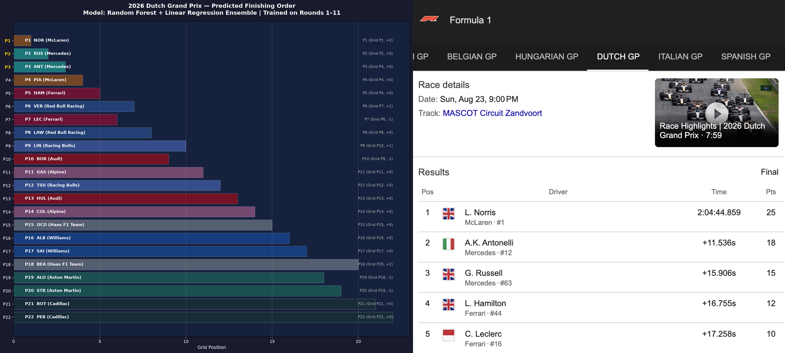


### 🇮🇹 Italian GP (Round 13)
* **Predicted Top 3:** 1. Russell, 2. Leclerc, 3. Verstappen
* **Actual Top 3:** 1. Antonelli, 2. Russell, 3. Verstappen
* **Result:** **2/3 on the podium** (Russell and Verstappen)! The model correctly identified Russell and Verstappen as podium contenders. Arguably would've also predicted the race winner had the Mercedes played with the Papaya rules (I feel for Russel❤️‍🩹)

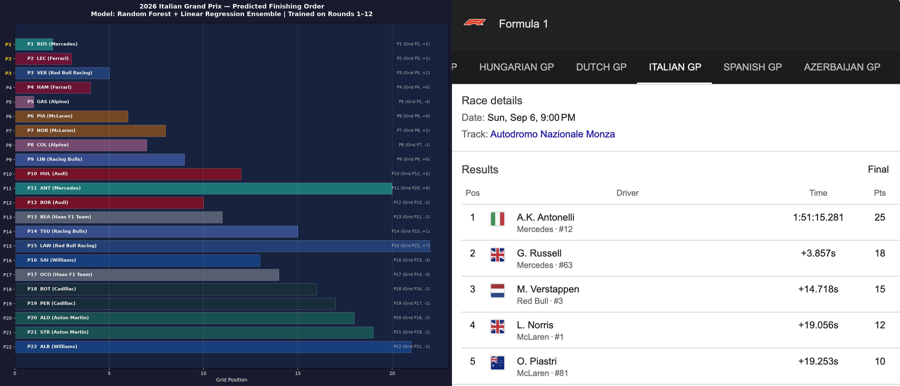


### 🇪🇸 Spanish GP (Round 14)
* **Predicted Top 5:** 1. Norris, 2. Antonelli, 3. Verstappen, 4. Leclerc, 5. Russell
* **Actual Top 5:** 1. Antonelli, 2. Verstappen, 3. Norris, 4. Leclerc, 5. Russell
* **Result:** **5/5 for the Top 5!** Although the model did not correctly identify the race winner, it correctly identified all 5 drivers who finished in the Top 5. 

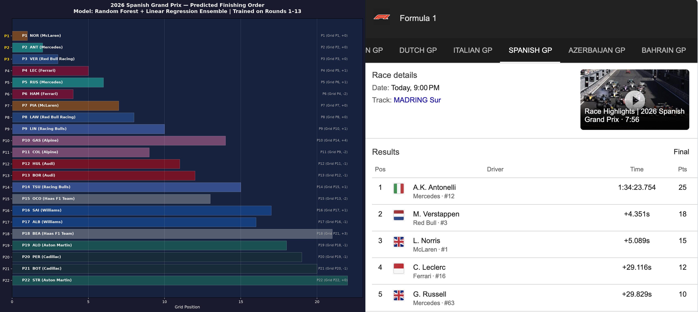


### 🇦🇿 Azerbaijan GP (Round 15)
* **Predicted Top 3:** 1. Russell, 2. Leclerc, 3. Hadjar
* **Actual Top 3:** 1. Russell, 2. Verstappen, 3. Hadjar
* **Result:** **2/3 of the podiums correct!** We successfully predicted George Russell to win and correctly placed Isack Hadjar in P3.

<p align="center">
  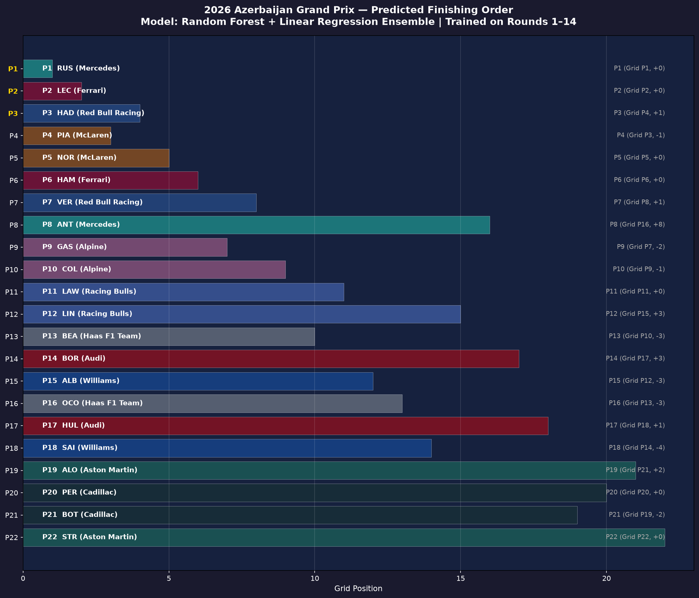
  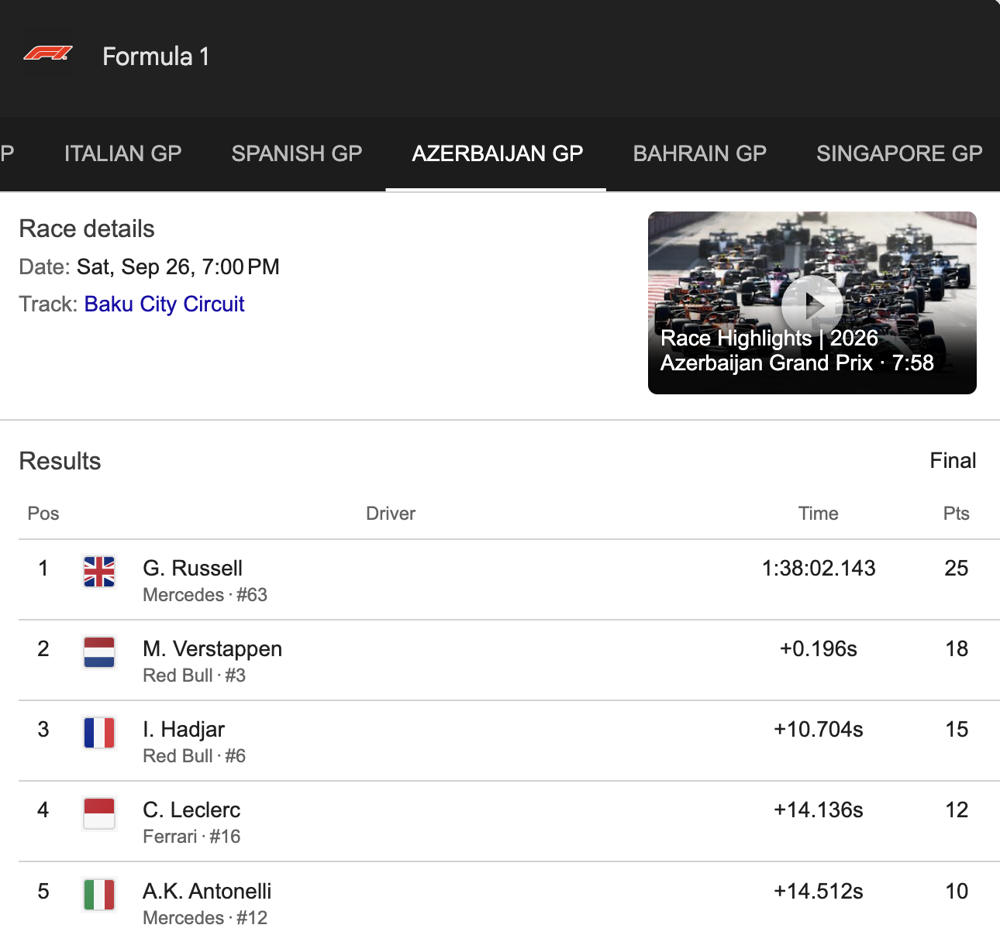
</p>


### 🇧🇭 Bahrain GP (Round 16, Sepang)
* **Predicted Top 5:** 1. Antonelli, 2. Verstappen, 3. Leclerc
* **Actual Top 5:** 1. Verstappen, 2. Antonelli, 3. Hamilton
* **Result:** **2/3 on the podium** (Verstappen and Antonelli)! The model correctly identified Verstappen and Antonelli as podium contenders.

<p align="center">
  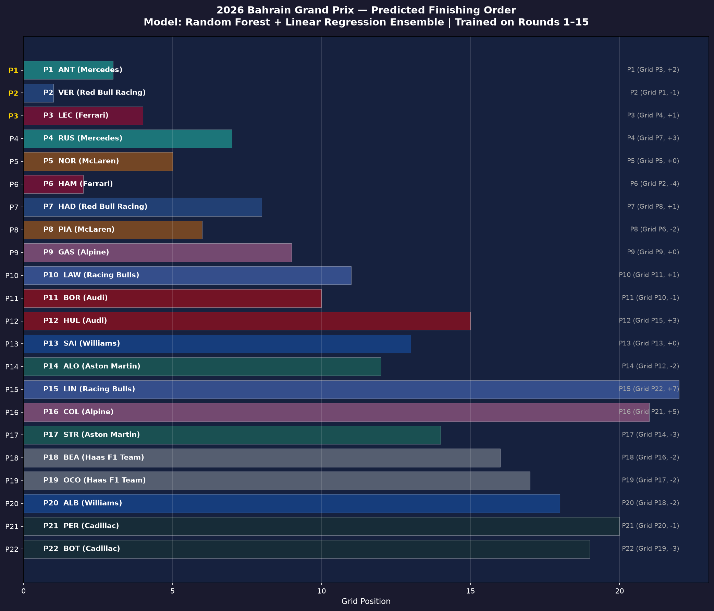
  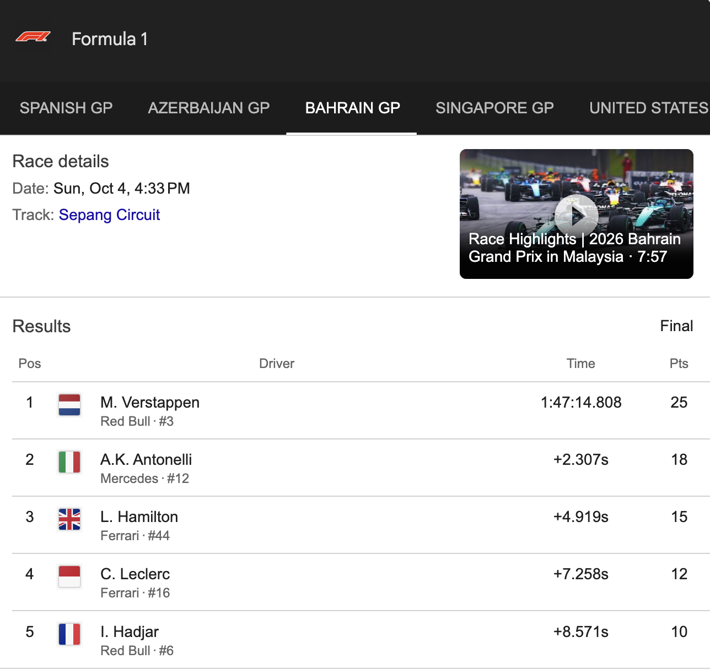
</p>


---

### 🇸🇬 Singapore GP (Round 17)
* **Predicted Top 5:** 1. Verstappen, 2. Antonellli, 3. Leclerc
* **Actual Top 5:** 1. Verstappen, 2. Leclerc, 3. Antonelli
* **Result:** **3/3 ON THE PODIUM!!!** Although we did not get the placements right, its the first time we got all 3 drivers on the podium correct.

<p align="center">
  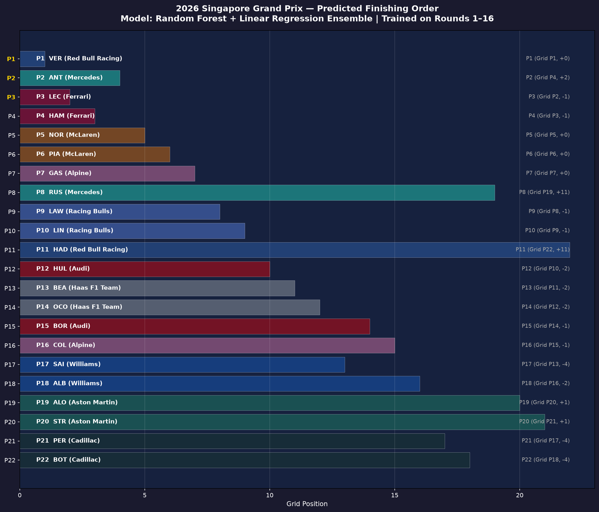
  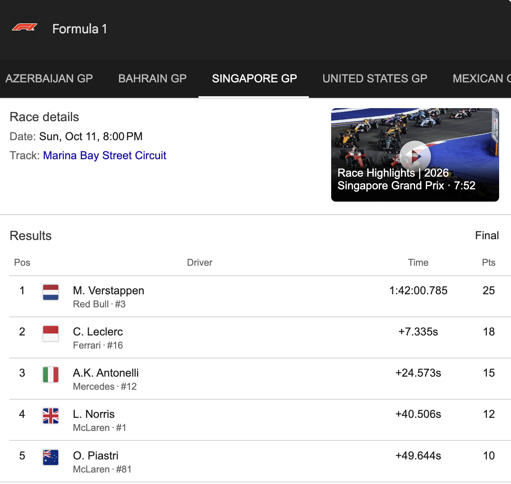
</p>

The existing pipeline now targets Singapore. All new artifacts are in `outputs/2026_singapore_gp/`, including qualifying and adjusted-grid CSVs, training and prediction feature matrices, validation predictions, charts, and the prediction report. Previous event outputs remain available in their existing folders. FastF1's local cache is ignored by Git.

---

## 📊 Act 1 — 2026 Pace Gap & Season Trends

**Goal:** Calculate `PositionsGained = GridPosition - FinishPosition` across the 16 completed 2026 races to identify over/underperformers and establish reliability baselines.

**Key findings:**
- **Verstappen (+2.58 avg)** consistently gains places on race day.
- **Antonelli (+1.60 avg)** gains places on average; **Russell (-0.54 avg)** loses slightly relative to his grid position.
- **21.0% DNF/non-start rate** across the season establishes a high baseline for mechanical failures and crashes in 2026.

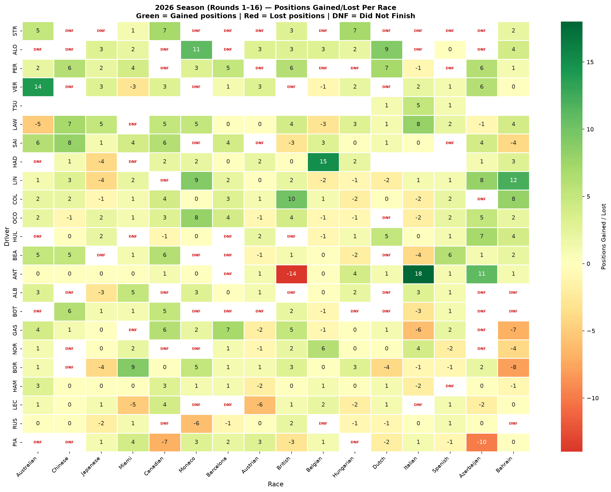
*Heatmap of positions gained and lost by driver across the 2026 season.*

---

## 🏁 Act 2 — Track Dominance

**Goal:** Compare the top two front-row starters using fastest-lap telemetry purely from the target Qualifying session (Verstappen vs Leclerc at Singapore).

**Key insight:** By analyzing 2026 telemetry, we identified exactly where the pole-sitter was pulling ahead in micro-segments of the track.

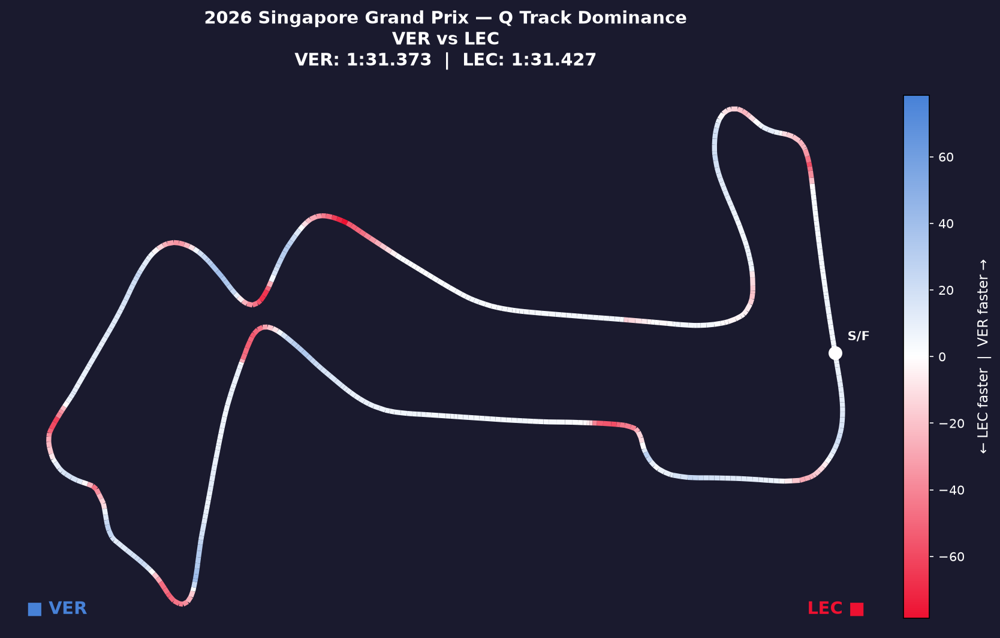
*Track dominance map highlighting which driver was faster in micro-segments of the track.*

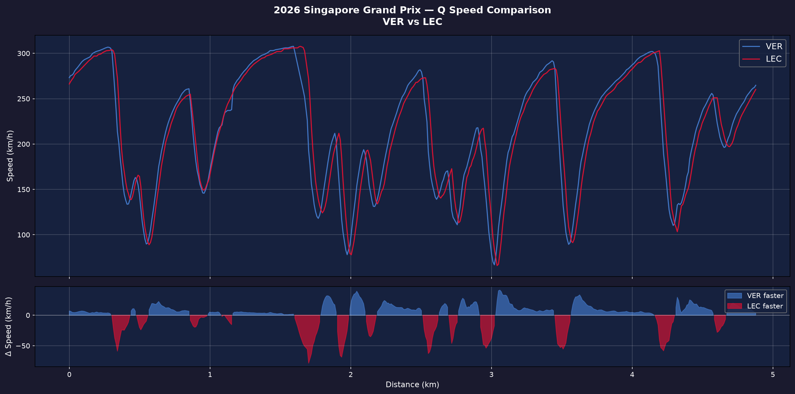
*Telemetry speed comparison trace during their fastest Q3 laps.*

---

## 🤖 Act 3 — Race Predictor Model

**Goal:** Predict the finishing order for all 22 drivers in the upcoming GP.

**Model:** Random Forest + Linear Regression ensemble, trained on the completed 2026 races (currently 16 races).

**Features (all knowable before race start):**
| Feature | Description |
|---------|-------------|
| `GridPosition` | Qualifying-derived starting position with published penalties |
| `DriverHistoricalGain` | Avg positions gained in 2026 (from Act 1) |
| `TeamRollingPoints` | Team's cumulative 2026 points |
| `DriverCompletionRate` | Reliability proxy (from Act 1) |
| `DriverAvgGrid` | Avg qualifying position this season |
| `GridVariance` | Qualifying consistency |
| `TeamDNFRate` | Team-level DNF rate |

*(Note: Historical performances from previous years are actively removed from the model to prevent massive historical bias from old regulations).*

**Walk-forward validation of the ensemble (test rounds 2–16):**
* **MAE:** 2.31 positions
* **R²:** 0.673
* **Podium/non-podium classification accuracy:** 87% (includes non-podium drivers; not full-podium hit rate)

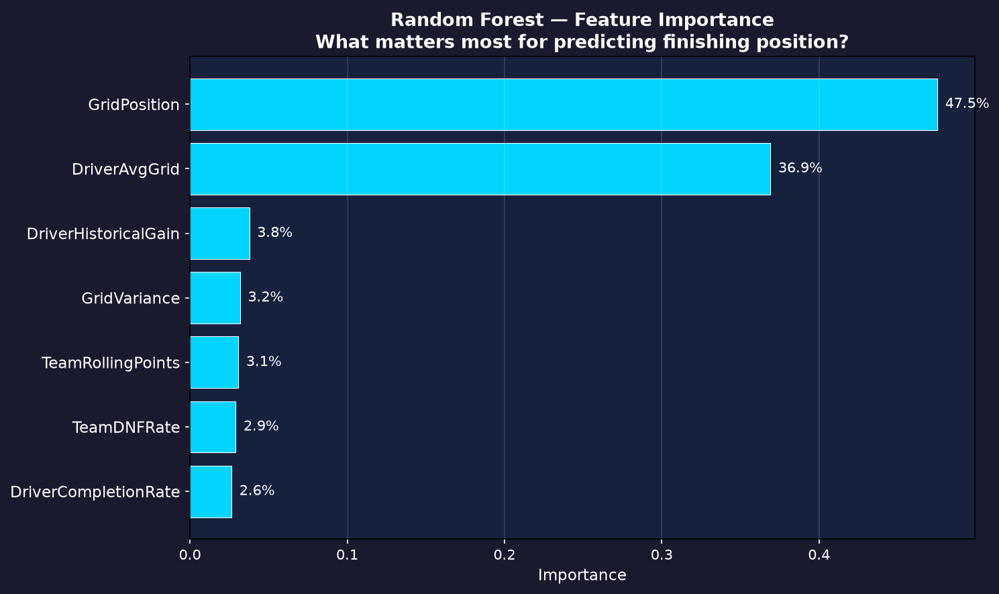
*Random Forest feature importance ranking.*

---

## 🛠️ Project Structure

```
fastf1-dutch-gp-2026/
├── src/
│   ├── config.py                 # Season config, starting grid, team colors
│   ├── data_loader.py            # FastF1 caching + session loading
│   ├── act1_pace_gap.py          # Act 1: Qualifying vs race performance
│   ├── act2_track_dominance.py   # Act 2: Singapore qualifying telemetry
│   └── act3_predictor.py         # Act 3: Race prediction model
│
├── outputs/                      # Generated charts, CSVs, reports
├── cache/                        # FastF1 data cache
├── requirements.txt
└── README.md
```

---

## 💻 Setup & Installation

**Prerequisites:** Python 3.9+

```bash
# Create virtual environment
python3 -m venv .venv
source .venv/bin/activate

# Install dependencies
pip install -r requirements.txt
```

---

## 🚀 How to Run

Run each Act in order — Act 3 depends on Act 1's output. Act 1 requires every round from 1 through 16 and stops if a race is unavailable. Driver statistics span team changes, and DNFs and non-starters are excluded from finishing-position targets. Make sure you use the virtual environment!

```bash
# Act 1: 2026 Season Pace Gap
.venv/bin/python -m src.act1_pace_gap

# Act 2: Track Dominance
.venv/bin/python -m src.act2_track_dominance

# Act 3: Race Prediction
.venv/bin/python -m src.act3_predictor
```

All outputs and charts are saved to `outputs/2026_singapore_gp/`. Singapore qualifying is cached automatically when Acts 2 or 3 load it. Pit-lane starters use effective positions 20–22; the model does not estimate a separate pit-lane time loss. The seven-feature model uses qualifying through starting position; Q lap times and telemetry are exported/analyzed but are not additional trained features.

---

## 🔧 Tech Stack

| Tool | Purpose |
|------|---------|
| [FastF1](https://docs.fastf1.dev/) | F1 telemetry and session data API |
| [pandas](https://pandas.pydata.org/) | Data manipulation and aggregation |
| [scikit-learn](https://scikit-learn.org/) | Random Forest and Linear Regression |
| [matplotlib](https://matplotlib.org/) & [seaborn](https://seaborn.pydata.org/) | Core plotting and visualizations |
